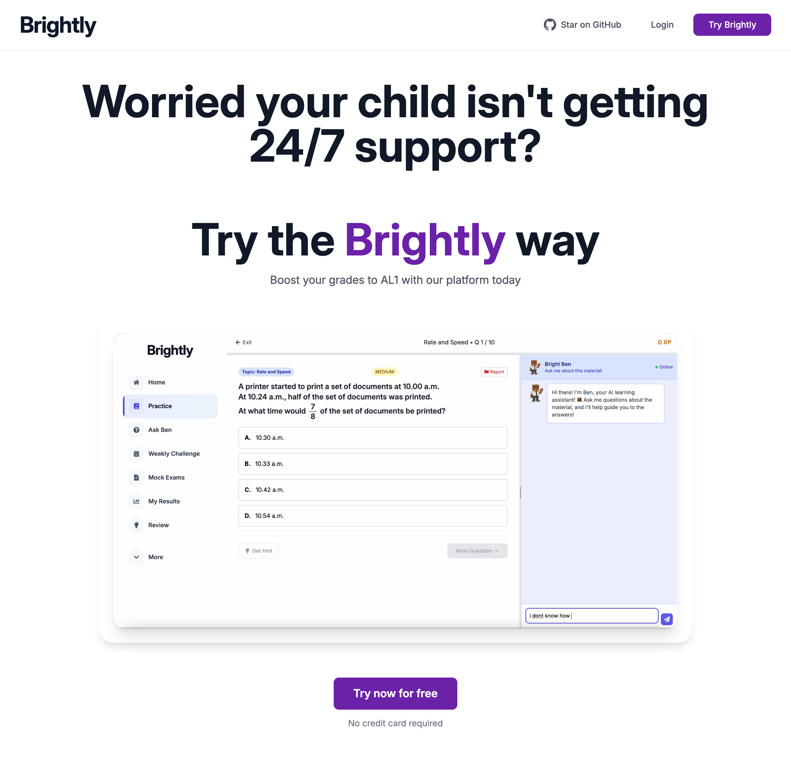

<div align="center">

# ✨ Brightly

### An open-source AI tutoring platform for PSLE preparation

Practice questions, mock exams, progress tracking, and **Bright Ben** — a 24/7 AI learning assistant that guides students step-by-step instead of just handing over answers.

[](LICENSE)
[](CONTRIBUTING.md)
[](https://nextjs.org/)
[](https://www.typescriptlang.org/)
[](https://supabase.com/)
[](https://www.prisma.io/)

<br />



</div>

---

## 📖 About

**Brightly** helps students prepare for the PSLE with a personalized, AI-assisted learning experience. Instead of rote memorization, it focuses on building genuine understanding — every question comes with an AI tutor that breaks problems down step-by-step.

It's **100% open source** under the [MIT License](LICENSE). Anyone can use it, fork it, self-host it, or build on top of it — no permission needed.

## 🚀 Features

- 🤖 **Bright Ben** — a 24/7 AI tutor that explains concepts and guides students to the answer
- 📝 **Practice & mock exams** — realistic questions with instant feedback
- 📊 **Progress tracking** — detailed analytics that show exactly where a student is improving
- 🎯 **Topical practice** — target specific weak areas by subject and topic
- 🏆 **Gamification** — XP, weekly challenges, and rewards to keep students motivated
- 👨‍👩‍👧 **Parent & student roles** — separate dashboards for families

## 🛠️ Tech Stack

| Layer          | Technology                                                                                    |
| -------------- | --------------------------------------------------------------------------------------------- |
| Framework      | [Next.js 14](https://nextjs.org/) (App Router), [TypeScript](https://www.typescriptlang.org/) |
| Styling        | [Tailwind CSS](https://tailwindcss.com/)                                                      |
| Database / ORM | [Postgres](https://www.postgresql.org/) via [Prisma](https://www.prisma.io/)                  |
| Auth & backend | [Supabase](https://supabase.com/)                                                             |
| AI             | OpenAI / OpenRouter                                                                           |

## 🏁 Getting Started

### Prerequisites

- [Node.js](https://nodejs.org/) v18 or higher
- npm
- A [Supabase](https://supabase.com) project and a Postgres database

### Installation

```bash
# 1. Clone the repo
git clone https://github.com/andrewchengg/edcel.git
cd edcel

# 2. Install dependencies
npm install

# 3. Set up environment variables
cp .env.example .env.local   # then fill in your own values
```

See [`.env.example`](.env.example) for the full list of variables and [ENVIRONMENT_SETUP.md](ENVIRONMENT_SETUP.md) for a step-by-step Supabase walkthrough.

> ⚠️ **Never commit real secrets.** `.env`, `.env.local`, and `*.pem` files are git-ignored — only `*.example` files with placeholders belong in version control.

### Run it

```bash
# Generate the Prisma client (first run / after schema changes)
npx prisma generate

# Start the dev server
npm run dev
```

Open [http://localhost:3000](http://localhost:3000) 🎉

### Build for production

```bash
npm run build
npm run start
```

## 📜 Scripts

| Command         | Description                  |
| --------------- | ---------------------------- |
| `npm run dev`   | Start the development server |
| `npm run build` | Build for production         |
| `npm run start` | Run the production build     |
| `npm run lint`  | Lint the codebase            |
| `npm run seed`  | Seed the database            |

## 🤝 Contributing

Contributions of all kinds are welcome — whether you're an educator, a parent, or a developer:

- 🐛 **Found a bug or have an idea?** [Open an issue](https://github.com/andrewchengg/edcel/issues).
- 🔧 **Want to contribute code?** Fork the repo, create a branch, and open a pull request.
- 🍴 **Want to make it your own?** The MIT License lets you do anything you like with the code.

Read the full [Contributing Guide](CONTRIBUTING.md) before you start, and see [SECURITY.md](SECURITY.md) for how to report vulnerabilities.

## 📄 License

Brightly is released under the [MIT License](LICENSE) — free to use, modify, and distribute for any purpose.

<div align="center">
<br />
Made with 💜 to help every student learn brightly.
</div>
